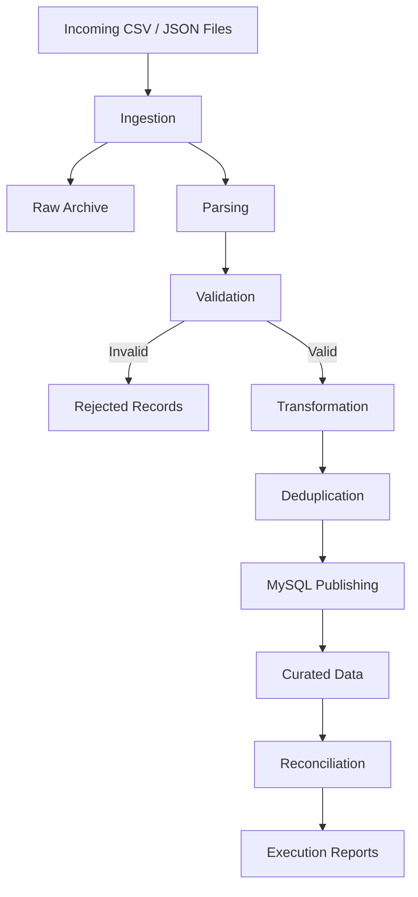

# Enterprise Data Ingestion & ETL Pipeline

A JavaScript-based batch data ingestion and ETL pipeline built with Node.js, Express.js, and MySQL. It processes CSV and JSON files, validates and transforms records, handles duplicate deliveries and conflicting records, and publishes curated data with execution tracking and reconciliation.

## Overview

The pipeline addresses common data ingestion challenges:

- Multiple input formats, including CSV and JSON.
- Malformed files and invalid records.
- Duplicate file deliveries and duplicate transaction records.
- Conflicting records with the same transaction ID.
- Referential integrity between customers and transactions.
- Late-arriving transaction events.
- Rejected-record tracking and reconciliation.

## Architecture

The pipeline follows a multi-zone processing architecture:

1. **Incoming:** Source files waiting to be processed.
2. **Raw:** Archived copies of ingested files.
3. **Validated:** Records that pass validation.
4. **Rejected:** Invalid or conflicting records retained for inspection.
5. **Curated:** Processed data stored in MySQL and date-partitioned files.

### Processing Flow



## Technology Stack

- **Runtime:** Node.js 20+
- **Language:** JavaScript (ES modules)
- **Backend:** Express.js
- **Database:** MySQL 8.0
- **Database driver:** mysql2
- **CSV processing:** csv-parse and csv-stringify
- **Logging:** Winston
- **Frontend:** React and Vite
- **Testing:** Node.js built-in test runner

## Project Structure

```text
enterprise-data-ingestion-etl-pipeline/
├── config/
│   └── config.js
├── data/
│   ├── incoming/
│   └── ground_truth_labels.json
├── docs/
│   ├── ARCHITECTURE.md
│   ├── DATA_DICTIONARY.md
│   └── DESIGN_DECISIONS.md
├── scripts/
│   └── backfillRejectionFingerprints.js
├── src/
│   ├── database/
│   │   ├── db.js
│   │   ├── initDb.js
│   │   └── schema.sql
│   ├── generators/
│   │   └── generateData.js
│   ├── ingestion/
│   │   └── ingestionService.js
│   ├── monitoring/
│   │   ├── logger.js
│   │   └── metricsService.js
│   ├── publishing/
│   │   └── publishingService.js
│   ├── reconciliation/
│   │   └── reconciliationService.js
│   ├── transformation/
│   │   └── transformationService.js
│   ├── validation/
│   │   └── validationService.js
│   ├── pipeline.js
│   ├── benchmark.js
│   └── reconcile.js
├── tests/
├── server.js
├── package.json
├── package-lock.json
└── README.md
```

## Database Design

The MySQL schema contains five primary tables:

| Table | Purpose |
|---|---|
| `customers` | Curated customer records |
| `transactions` | Curated transaction records |
| `pipeline_runs` | Pipeline execution history and metrics |
| `processed_files` | File hashes and processing history |
| `rejected_records` | Rejected records and their reasons |

See `docs/DATA_DICTIONARY.md` for the detailed schema and `docs/ARCHITECTURE.md` for the architecture.

## Getting Started

### Prerequisites

- Node.js 20 or later
- npm
- MySQL 8.0

### 1. Clone the repository

```bash
git clone https://github.com/moluguri777-maker/enterprise-data-ingestion-etl-pipeline.git
cd enterprise-data-ingestion-etl-pipeline
```

### 2. Install dependencies

```bash
npm install
```

### 3. Configure environment variables

Create a local `.env` file using `.env.example` as a reference.

Configure your MySQL connection:

```env
MYSQL_HOST=127.0.0.1
MYSQL_PORT=3306
MYSQL_USER=root
MYSQL_PASSWORD=your_password
MYSQL_DATABASE=pipeline_curated
MYSQL_DATABASE_TEST=pipeline_curated_test
```

Do not commit your `.env` file or database credentials.

### 4. Initialize the database

```bash
npm run init-db
```

### 5. Generate sample input data

```bash
npm run generate-data
```

The generator creates sample customer and transaction files in `data/incoming/`.

### 6. Run the pipeline

```bash
npm run pipeline
```

### 7. Run reconciliation

```bash
npm run reconcile
```

## Available Commands

| Command | Description |
|---|---|
| `npm run generate-data` | Generate reproducible sample datasets |
| `npm run init-db` | Initialize the MySQL schema |
| `npm run pipeline` | Execute the ingestion pipeline |
| `npm run reconcile` | Run data reconciliation |
| `npm run benchmark` | Run the pipeline benchmark |
| `npm test` | Run the complete automated test suite |
| `npm run test:unit` | Run unit tests |
| `npm run test:integration` | Run integration tests |
| `npm run dev` | Start the Express server with Vite development middleware |
| `npm run build` | Build the frontend |
| `npm start` | Start the Express server |

## Idempotency and Duplicate Handling

The pipeline uses file-level and record-level mechanisms to support safe reprocessing.

- Files are identified using SHA-256 hashes.
- Identical transaction deliveries are treated as duplicates.
- Conflicting records with an existing transaction ID are rejected rather than silently overwriting existing data.
- Rejected records are retained with their associated reasons and fingerprints.
- Pipeline execution history is recorded in MySQL.

## Monitoring and Reconciliation

Pipeline execution metrics include input, valid, rejected, duplicate, inserted, and updated record counts.

The reconciliation process checks whether input records are accounted for across processing outcomes. Execution reports are exported for inspection.

## Automated Test Results

The automated test suite was executed successfully.

| Test Suite | Tests Passed |
|---|---:|
| Edge cases | 3/3 |
| Idempotency | 4/4 |
| Ingestion | 4/4 |
| Transformation | 4/4 |
| Validation | 8/8 |
| **Total** | **23/23** |

- Failed tests: 0
- Test runner: Node.js built-in test runner
- Execution time: approximately 7.93 seconds

## Operations API

The Express server exposes endpoints for pipeline monitoring and operations:

| Endpoint | Purpose |
|---|---|
| `GET /api/reconciliation` | Run reconciliation |
| `GET /api/runs` | Retrieve recent pipeline runs |
| `POST /api/pipeline/run` | Trigger pipeline execution |
| `POST /api/pipeline/generate` | Generate synthetic input data |
| `GET /api/transactions` | Retrieve curated transactions |
| `GET /api/rejected` | Retrieve rejected records |
| `GET /api/zones` | View storage-zone information |

## Documentation

- `docs/ARCHITECTURE.md` — Architecture and processing design.
- `docs/DATA_DICTIONARY.md` — Database entities and field definitions.
- `docs/DESIGN_DECISIONS.md` — Implementation decisions and trade-offs.

## Known Limitations and Future Improvements

- Distributed processing for horizontal scalability.
- Schema registry integration for formal schema evolution.
- Change Data Capture (CDC) for downstream consumers.
- Further performance optimization and operational monitoring.

---

## AI Usage and Prompt History

AI tools, including ChatGPT, were used throughout the development of this project for architecture discussions, implementation guidance, debugging, testing, and documentation.

AI assistance was used as a development aid, while the implementation, integration, and validation were carried out through my own work. I reviewed and tested the suggestions against the actual project to ensure they aligned with the requirements.

The [`docs/AI_PROMPT_HISTORY.md`](docs/AI_PROMPT_HISTORY.md) file contains prompts and development discussions that illustrate how AI was used during the project. The `docs` directory also includes supporting development documentation and the available conversation records.

**Built with JavaScript, Node.js, Express.js, and MySQL.**
