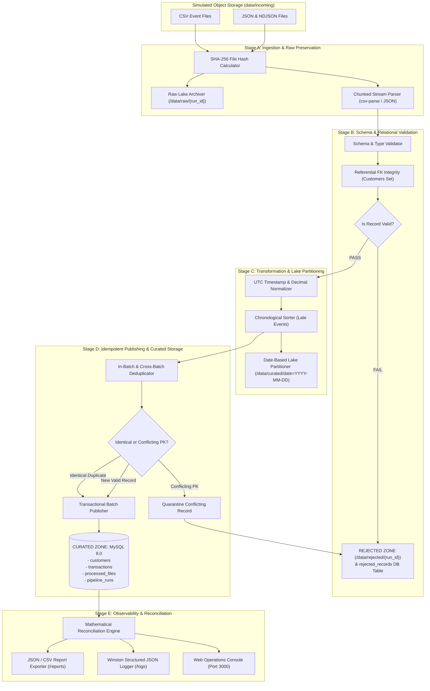

# Enterprise Data Engineering Pipeline Architecture

## 1. Executive Summary

This project implements a production-grade, idempotent, multi-zone Data Engineering Ingestion & ETL pipeline built with Node.js, Express, and MySQL 8.0.

The pipeline ingests heterogeneous business event streams (CSV, JSON, and NDJSON) arriving in simulated object storage, validates schemas and relational constraints, enforces data hygiene, prevents duplicate publishing, and loads pristine datasets into the Curated Zone with full lineage and mathematical reconciliation.

---

## 2. Mermaid Architecture Diagram

---

## 3. Data Lake Zone Architecture

The pipeline partitions data across four distinct storage zones simulating cloud object storage (e.g. AWS S3, Google Cloud Storage):

### 1. Ingestion / Landing Zone (`/data/incoming`)
- Transient bucket where external producers drop source files (batches of customers, payments, sales, and refunds).
- Supports mixed CSV, JSON array, and NDJSON files.

### 2. Raw Zone (`/data/raw/{run_id}/`)
- Immutable historical archive.
- Original files are copied verbatim into run-partitioned directories before parsing.
- Guarantees byte-for-byte reproducibility and disaster recovery.

### 3. Validated Zone (`/data/validated/{run_id}/`)
- Intermediate staging zone containing structured records that passed structural validation.
- Serialized in clean JSON batches prior to database insertion.

### 4. Rejected Quarantine Zone (`/data/rejected/{run_id}/`)
- Dead-letter queue for anomalous records.
- Stores full original record, source file, timestamp, and human-readable validation error messages.
- Prevents silent data corruption while ensuring 100% data accountability.

### 5. Curated Zone (`/data/curated/` & Target Relational DB)
- **Filesystem Lake**: Partitioned by date (`/data/curated/transactions/date=YYYY-MM-DD/part-{run_id}.json`).
- **Relational Curated Database**: High-performance normalized tables (`customers`, `transactions`, `processed_files`, `pipeline_runs`, `rejected_records`).

---

## 4. Key Architectural Patterns

### 4.1 Two-Tier Idempotency Model
1. **Tier 1 (File-Level Detection)**:
   - Every file's SHA-256 cryptographic digest is calculated and logged in `processed_files`.
   - Repeated delivery of an identical file is flagged as a re-delivery.
2. **Tier 2 (Record-Level Deduplication & Conflict Isolation)**:
   - Naive pipelines skip an entire file if marked duplicate. Our pipeline parses every row to support **mixed batches** (files containing a mixture of existing and new events).
   - If `transaction_id` matches an existing record and all attributes match, it is treated as an **identical duplicate** (safely skipped, incrementing `duplicate_records_count`).
   - If `transaction_id` matches but attributes conflict (e.g. different amount or customer), the event is flagged as a **Primary Key Conflict** and routed to quarantine.

### 4.2 Referential Integrity via Pre-Cached Keys
- To prevent slow row-by-row SELECT queries for foreign key validation, the pipeline pre-loads existing customer keys into an in-memory `Set` ($O(1)$ lookup).
- When new customer records arrive in the same batch, their IDs are immediately registered into the set, allowing subsequent transactions in that same run to satisfy foreign keys seamlessly.

### 4.3 Out-of-Order & Late Event Handling
- Financial transactions often arrive days or months late due to network partitioning or batch delays.
- The pipeline sorts incoming transaction streams chronologically by UTC timestamp before committing and partitions the filesystem lake by `transaction_date` rather than processing date.

### 4.4 Automated Mathematical Reconciliation
Every execution validates the reconciliation balance:
$$\text{Input Records} = \text{Inserted} + \text{Duplicates} + \text{Rejected} + \text{Updated}$$
Any discrepancy produces an audit alert and flags the run status.
